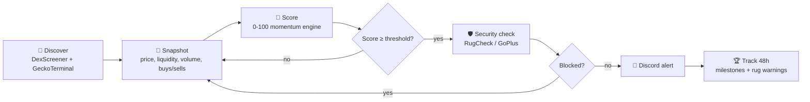

<div align="center">

# 🚀 Memecoin Launch Signal Bot

**Catch new memecoin launches while they're still early, with the security checks already done.**

An alert-only Discord bot that scans fresh pools across 4 chains, scores momentum from 0 to 100, filters out rugs, and tracks every call it makes.


[Features](#-features) · [Quick Start](#-quick-start) · [Commands](#-slash-commands) · [How It Works](#-how-it-works) · [Configuration](#-configuration) · [Disclaimer](#-disclaimer)

</div>

---

## ✨ Features

| | |
|---|---|
| 🔎 **Multi-source discovery** | DexScreener profiles + GeckoTerminal new pools |
| ⛓️ **4 chains** | Solana, Base, Ethereum, BSC |
| 🛡️ **Security gate** | RugCheck (Solana) and GoPlus (EVM): honeypots, mint/freeze authority, taxes, LP lock |
| 🧠 **0-100 signal engine** | Volume surge, price jump, buy pressure, liquidity health, socials, earliness |
| 🚫 **Anti-scam penalties** | Wash-trade detection, bot-volume penalty, "already pumped" filter |
| 🏷️ **Alert tiers** | `⚡ SPIKE` and `🔥 STRONG` |
| 🏆 **Milestone tracking** | Replies to the original alert at 1.5x, 2x, 3x, 5x, 10x, 25x, 50x, 100x |
| 🚨 **Rug warnings** | Flags alerted coins when liquidity or price collapses |
| 📊 **Win-rate stats** | 7-day performance saved in SQLite |
| 🔘 **Link buttons** | Chart, security report, explorer, GMGN in one click |

> 🔒 **Alert-only.** No wallets, no private keys, no trading, no paid API keys. The bot reads public data and posts messages. Every decision is yours.

---

## 👀 What an alert looks like

```
🔥 STRONG LAUNCH SPIKE - Example Coin ($EXMPL)

📈 $4.2K traded in ~58s - 6.1x its earlier pace
🚀 Price +27.4% in the last ~110s
🟢 18 buys vs 5 sells in ~58s
💧 Liquidity growing

Score        ██████████░  84/100          Age   7m old · SOLANA
Price        $0.0000412                   Market Cap   $41.2K
Liquidity    $12.8K                       Total volume $9.6K

Security     ✅ No red flags found
             🔒 LP locked/burned: 100%
             via RugCheck

[📊 Chart] [🛡️ RugCheck] [🔍 Explorer] [🧠 GMGN]
```

*Illustrative example, not a real token.*

---

## ⚡ Quick Start

### 1. Install

```bash
git clone https://github.com/YOUR_USERNAME/YOUR_REPO.git
cd YOUR_REPO

python -m venv venv
source venv/bin/activate        # Windows: venv\Scripts\activate

pip install discord.py aiohttp python-dotenv
```

### 2. Create your Discord bot

1. Go to the [Discord Developer Portal](https://discord.com/developers/applications) and create an application with a bot.
2. Copy the **bot token**.
3. Invite it with the `bot` and `applications.commands` scopes.
4. Grant **Send Messages** and **Embed Links** in your alert channel.

> No privileged intents needed.

### 3. Configure

Create a `.env` file next to the script:

```env
DISCORD_TOKEN=your_bot_token
ALERT_CHANNEL_ID=123456789012345678
```

### 4. Run

```bash
python bot.py
```

The bot announces itself in your alert channel and starts scanning. 🎯

---

## 🎮 Slash Commands

| Command | Who | What it does |
|---|:---:|---|
| `/check <chain> <address>` | 👥 Everyone | Full analysis and security check of any token |
| `/top [count]` | 👥 Everyone | Highest-scoring new coins right now |
| `/status` | 👥 Everyone | Bot health, settings and scan stats |
| `/stats` | 👥 Everyone | Alert performance over the last 7 days |
| `/watchlist` | 👥 Everyone | Show watched tokens |
| `/watch <chain> <address>` | 🔑 Manage Server | Always track a specific token |
| `/unwatch <chain> <address>` | 🔑 Manage Server | Stop tracking a token |
| `/threshold <1-100>` | 🔑 Manage Server | Set the minimum alert score |
| `/pause` · `/resume` | 🔑 Manage Server | Pause or resume alerts (tracking continues) |
| `/scan` | 🔑 Manage Server | Run a scan immediately |

---

## 🧠 How It Works



<details>
<summary><b>📐 Scoring breakdown (click to expand)</b></summary>

<br>

| Signal | Max points | Notes |
|---|:---:|---|
| 📈 Volume surge vs. own earlier pace | 25 | Measured from live snapshots, not lifetime totals |
| 🚀 Price jump (~2 min window) | 20 | Halved if sellers are winning |
| 🟢 Buy/sell flow | 15 | Sellers dominating gives -10 |
| 🌱 Lifetime traction | 10 | Transactions and total volume |
| 💧 Liquidity trend | 5 | Growing liquidity bonus |
| ⚖️ Liquidity vs. market cap | 5 | Thin liquidity gives -5 |
| ⏱️ Earliness | 5 | Younger coins score higher |
| 🌐 Socials / website | 5 | Twitter, Telegram, site |
| 🛡️ Security | +8 / -39 | Clean report is rewarded, red flags are penalized |
| ⚠️ Chasing / wash volume | -8 / -15 | Already pumped, or tiny bot-like trades |

**Hard blocks (alert is never sent):** honeypot, mint authority, freeze authority, copycat/rugged flags, taxes of 15% or more, owner-controlled balances, liquidity down 30%+ from peak.

</details>

---

## ⚙️ Configuration

Only `DISCORD_TOKEN` and `ALERT_CHANNEL_ID` are required. Everything else has a sensible default.

<details>
<summary><b>🔧 All optional settings (click to expand)</b></summary>

<br>

| Variable | Default | Description |
|---|---|---|
| `WARNING_CHANNEL_ID` | alert channel | Separate channel for rug warnings |
| `GUILD_ID` | none | Your server ID, for instant slash-command sync |
| `CHAINS` | `solana,base,ethereum,bsc` | Chains to scan |
| `DATA_DIR` | `.` | Where the SQLite database is stored |
| `LOG_LEVEL` | `INFO` | Logging verbosity |
| `SCAN_INTERVAL_SECONDS` | `20` | Delay between scans |
| `GECKO_PAGES_SOLANA` | `2` | GeckoTerminal pages read for Solana |
| `MAX_TRACKED_TOKENS` | `250` | Max coins tracked at once |
| `MAX_PAIR_AGE_MINUTES` | `30` | What counts as a "new" coin |
| `SPIKE_WINDOW_SECONDS` | `60` | Volume and buy/sell window |
| `PRICE_WINDOW_SECONDS` | `120` | Price-jump window |
| `MIN_SPIKE_VOLUME_USD` | `1000` | Minimum volume inside the spike window |
| `MAX_GAIN_SINCE_LAUNCH_PCT` | `400` | Skip coins already up this much |
| `MIN_LIQUIDITY_USD` | `5000` | Minimum liquidity |
| `MIN_TOTAL_TXNS` | `25` | Minimum lifetime transactions |
| `MIN_TOTAL_VOLUME_USD` | `2000` | Minimum lifetime volume |
| `ALERT_SCORE_THRESHOLD` | `60` | Minimum score to alert |
| `STRONG_SCORE_THRESHOLD` | `80` | Score for the 🔥 STRONG tier |
| `ALERT_COOLDOWN_SECONDS` | `1200` | Cooldown per token between alerts |
| `MAX_ALERTS_PER_SCAN` | `5` | Alert cap per scan |
| `MAX_SECURITY_CHECKS_PER_SCAN` | `12` | Security API calls per scan |
| `STRICT_SECURITY` | `false` | Any security danger or warning blocks the alert |
| `REQUIRE_SECURITY_CHECK` | `false` | Block coins whose security couldn't be verified |

</details>

---

## 📁 Project Structure

```
.
├── bot.py            # the bot
├── .env              # your secrets (never commit this!)
└── launch_bot.db     # SQLite database (auto-created)
```

Recommended `.gitignore`:

```
.env
*.db
venv/
__pycache__/
```

---

## 🚧 Limitations

- Free public APIs mean rate limits and occasional outages.
- Security data can lag on brand-new tokens. "Unverified" is flagged, never assumed safe.
- Peak performance is sampled once per scan, so brief spikes between scans can be missed.
- Scores are heuristics, not predictions.

---

## ⚠️ Disclaimer

> **This project is for educational and informational purposes only and is not financial advice.**
>
> Memecoins are extremely volatile and high-risk. Most new tokens go to zero, and rug pulls and scams are common. A high score or a clean security report does **not** mean a token is safe or will go up. Do your own research and never risk more than you can afford to lose. The authors accept no liability for any losses.

---

## 🤝 Contributing

Issues and pull requests are welcome. If you have ideas for new signals or security sources, open an issue.

## 📄 License

GNU GPLv3 (General Public License v3)

<div align="center">

**If this project helps you, consider giving it a ⭐**

</div>
